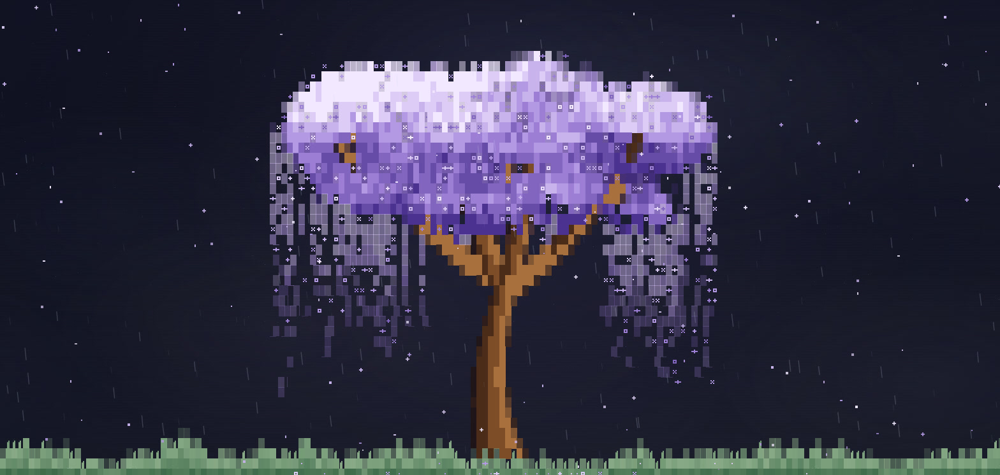
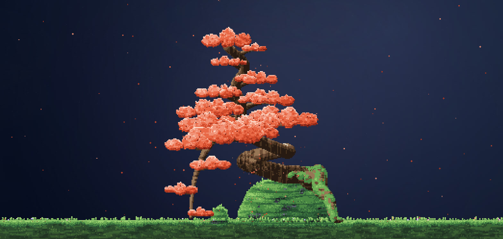
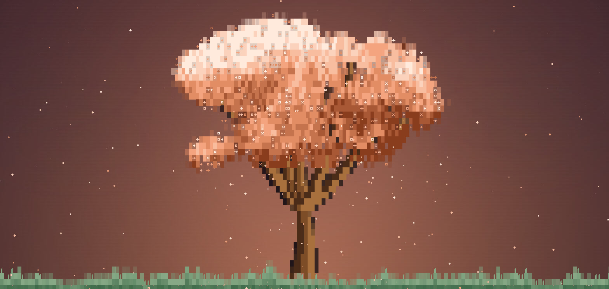
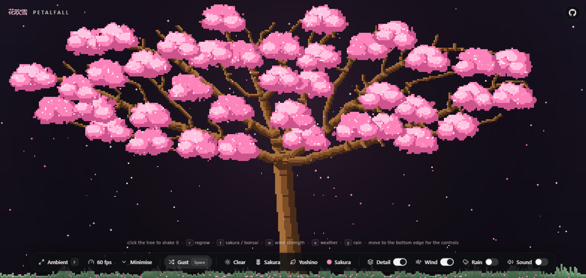

# Petalfall 花吹雪

A cherry blossom tree that grows itself on a web page. Petals fall from the crown, drift on a
wandering wind, settle in the grass and fade. Every time you regrow it, the tree comes out
different. There is also a bonsai, growing out of a mossy rock.

It is both a little app you can open in your browser and a small library you can add to any
website.

Plain TypeScript and Canvas 2D. No runtime dependencies. The whole app is about 29 KB gzipped, and
the library on its own is about 21 KB.

<p align="center">
  
</p>

| A kengai bonsai in maple, under moonlight | Cell mode, sunset |
| --- | --- |
|  |  |

## What is Petalfall

Petalfall is a small program that draws a tree on a canvas, pixel by pixel, using rules instead of
predrawn images. When the page loads, it grows a brand new tree. Wind moves through it, blossom
clusters ripple, and petals come loose and fall to the grass. Click the tree and it shakes. Press a
key and it regrows into something new. Change the weather and the whole sky changes with it.

You do not need to know how any of that works to enjoy it. Open the app, click around, and play.

## Why I built this

As a visual learner, I have always wanted to make things more interactive instead of just staring
at static content. I wanted something I could actually play around with, customise, and experience
visually, especially on my own pages, where a hero image just sits there doing nothing.

So I built this. A scene that grows a tree procedurally, drops petals when the wind moves it, lets
you shake blossom loose with a click, change the weather, and regrow a completely different tree on
a whim. A simple idea, turned into something interactive, visually engaging, and honestly just fun
to fiddle with.

## The problem it solves

Static banners and hero images are dead weight, and a video background costs megabytes for a loop
you stop noticing after five seconds. I wanted a background that is alive but nearly free.

* **Tiny.** About 21 KB gzipped for the library, zero dependencies, one canvas, no image files and
no audio files.
* **Cheap to run.** You can cap the frame rate at 24, 30, 45 or 60 frames per second. It stops
drawing when you scroll it out of view, and it calms down for people who prefer reduced motion.
* **Flexible.** Use it as a fullscreen ambient wallpaper, a hero section, a card on your page, or a
transparent overlay drawn over your existing background.

## Features

* **Two looks.** Cell mode is blocky, in the style of a terminal. Detail mode is a fully branched
pixel tree whose limbs fork and taper into twigs.
* **Two trees.** A cherry in blossom, and a bonsai with a gnarled trunk and layered pads of leaves,
growing from a mossy rock, with boulders and wild flowers.
* **Eleven bonsai styles** such as windswept, twin trunk, cascade and broom, and **three kinds of
cherry** (spreading, rounded, weeping), or let it pick randomly. No two trees are alike.
* **Alive.** Petals sway and tumble as they fall, blossom clusters ripple, and clicking or dragging
on the tree shakes blossom loose and sends ripples through it.
* **Wind and weather.** A wind that wanders and gusts. Clear, sunset, moonlight, overcast and mist
skies. A rain switch that works on top of any of them.
* **Sixteen colours** for blossom and leaves, from sakura pink to lavender, mint, gold, maple and
autumn.
* **Ambient mode** as a wallpaper. Fullscreen, controls fade away when idle, and a live frame rate
readout.
* **Synthesised sound.** Wind, rain and a chime on click, all generated in the browser. Nothing
loads until you switch it on.
* **Works on a phone.** The controls collapse into a small menu button and open as a panel across
the bottom.
* Settings are remembered between visits.

## Demo and screenshots

Regrow the tree, change the weather, switch to the bonsai. The app itself is the demo.

**Live demo: [petalfall-cyn.pages.dev](https://petalfall-cyn.pages.dev)**

## Tech stack

* **TypeScript** for all of the code.
* **Canvas 2D** for every frame. Nothing is a recorded animation or a sprite sheet.
* **Web Audio API** for the wind, rain and chimes, all synthesised on the fly.
* **Vite** for the dev server and the builds.
* **Zero runtime dependencies.**

## How to run it on your computer

You need Node.js version 20 or newer. If you do not have it, download the LTS installer from
[nodejs.org](https://nodejs.org) and install it with the default options. You only do this once.

1. **Get the project.** Go to the GitHub page, click the green **Code** button and choose
**Download ZIP**, then unzip it anywhere you like. If you use git, you can instead run
`git clone https://github.com/Sadat-Rakib/petalfall.git`.
2. **Open a terminal in the project folder.** On Windows, open the folder, then type `cmd` in the
address bar and press Enter. On a Mac, right click the folder and choose **New Terminal at Folder**.
3. **Install the tools it needs.** Type this and press Enter:

```bash
npm install
```

4. **Start the app.**

```bash
npm run dev
```

5. **Open http://localhost:5173 in your browser.** You should see your first tree growing.

To stop the app, press `Ctrl` and `C` together in the terminal.

### What the commands do

| Command | What it does |
| --- | --- |
| `npm run dev` | Starts the app on your computer with live reload while you edit. |
| `npm run build` | Checks the code and builds the website into a `dist` folder. |
| `npm run preview` | Serves the built website so you can check it before putting it online. |
| `npm run build:lib` | Builds `lib/petalfall.iife.js`, the single file you can drop into any website. |

## How to use it on your own website

### The simple way, with one script tag

1. In the project folder, build the library file once:

```bash
npm run build:lib
```

2. Copy `lib/petalfall.iife.js` into the same folder as your HTML file.
3. Add two lines to that HTML file:

```html
<script src="petalfall.iife.js"></script>

<petalfall palette="lavender" weather="moonlight" style="height: 420px"></petalfall>
```

That is the whole thing. The `<petalfall>` tag grows a tree inside itself. Give it a width and a
height, and pick options from the table below.

### As a page background

Add a small script and the tree draws behind everything else on the page. Only the tree, the petals
and the rain are drawn, so your page shows through, and clicks still reach your buttons.

```html
<script src="petalfall.iife.js"></script>
<script>
  window.Petalfall.createPetalfall(document.body, {
    background: "transparent",
    interactive: false
  });
</script>
```

### In a React, Vue, Svelte or Astro project

Once the package is on npm, install it with `npm install petalfall` and then:

```js
import { createPetalfall } from "petalfall";

const petalfall = createPetalfall("#hero", {
  palette: "lavender",
  form: "shidare",
  weather: "moonlight"
});
```

Until then, use the script tag way above. You can also import `petalfall/element` to register the
`<petalfall>` tag inside a bundled project.

### Changing things later

Call methods on the object you got back, or change the attributes of the tag:

```js
petalfall.set({ palette: "mint", rain: true });
petalfall.regrow();      // a brand new tree
petalfall.gust();        // a burst of wind
petalfall.destroy();     // remove it from the page
```

### The options

Every option is optional. Leave one out and it keeps its default.

| Option | Default | What it does |
| --- | --- | --- |
| `tree` | `"sakura"` | `"sakura"` grows a cherry in blossom, `"bonsai"` grows a tree on a mossy rock. |
| `palette` | `"sakura"` | The blossom or leaf colour. Choices: `sakura` `blush` `rose` `peach` `coral` `gold` `lavender` `violet` `sky` `mint` `matcha` `white` `pine` `juniper` `maple` `autumn`. |
| `form` | `"yoshino"` | The shape of the tree. Cherry shapes: `yoshino`, `bush`, `shidare` (weeping) or `random`. Bonsai shapes: `moyogi`, `chokkan`, `shakan`, `fukinagashi`, `sokan`, `hokidachi`, `ishitsuki`, `nejikan`, `hankengai`, `kengai`, `bunjin` or `random`. |
| `detail` | `false` | `true` for the finely branched pixel tree, `false` for the blocky cell style. The bonsai is always drawn finely. |
| `petals` | `5` | How many petals fall, from 1 to 10. |
| `wind` | `3` | Wind strength from 0 to 10, or `false` for still air. |
| `weather` | `"clear"` | `clear`, `sunset`, `moonlight`, `overcast` or `mist`. |
| `rain` | `false` | Rain falling through the weather. |
| `background` | `"sky"` | `"sky"` draws its own night sky. `"transparent"` draws only the tree, petals and rain. |
| `fps` | `60` | Draw at most this many frames per second, from 5 to 60. |
| `seed` | random | The same seed grows the same tree every time. |
| `sound` | `false` | Wind and rain sound, and a chime on click. Browsers only allow sound after a click or key press. |
| `interactive` | `true` | Clicking or dragging shakes the blossom. Turn it off to let clicks pass through to your page. |
| `cursor` | `true` | A little arrowhead cursor in the blossom colour over the scene. |

## The controls in the app

Everything is in the bar at the bottom: Ambient, a live frame rate readout, Minimise, a Gust button,
dropdowns for the weather, the tree, its shape and its colour, and switches for Detail, Wind, Rain
and Sound. Minimise tucks the bar away into a small round button in the bottom right corner. Tap it
to bring the bar back, or drag it anywhere you like. On a phone the controls start tucked away and
open as a panel across the bottom.



The keyboard works too:

| Key | What it does |
| --- | --- |
| click or tap the tree | Shake blossom loose and send a gust through the air. |
| `space` | A gust of wind. |
| `r` | Regrow the tree into a brand new shape. |
| `t` | Switch between the cherry and the bonsai. |
| `s` | Change the shape of the current tree. |
| `c` and `C` | Next or previous colour. |
| `d` | Detail mode on or off. |
| `p` and `P` | More or fewer petals. |
| `w` and `W` | More or less wind. |
| `a` | Wind on or off. |
| `e` and `E` | Next or previous weather. |
| `y` | Rain on or off. |
| `m` | Sound on or off. |
| `f` | Ambient mode. Fullscreen, and the controls fade away after a couple of idle seconds. |

## How to put it online

The app is a static site, so any free host works. Build it with `npm run build` and host the `dist`
folder.

On Cloudflare Pages: create a Pages project, connect this repository, set the build command to
`npm run build` and the output directory to `dist`. Every push then updates the site. You can also
deploy straight from the command line:

```bash
npm run build
npx wrangler pages deploy dist
```

This repository also includes a GitHub Actions workflow that deploys to Cloudflare Pages on every
push once you add your Cloudflare API token and account id as repository secrets and set a
repository variable named `CLOUDFLARE_DEPLOY` to `on`.

## Licence

Petalfall is released under the MIT licence. The full text is in the `LICENSE` file, and the
third party notices are collected in `NOTICE.md`.
